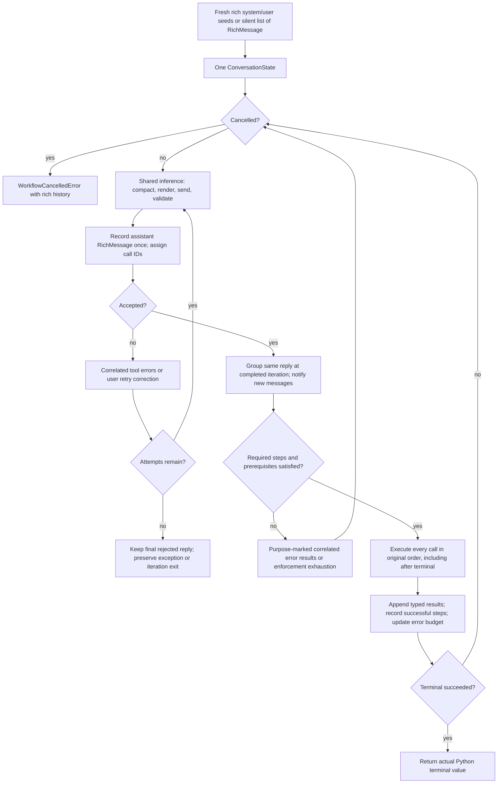
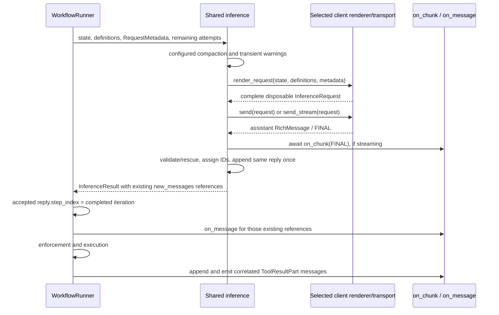
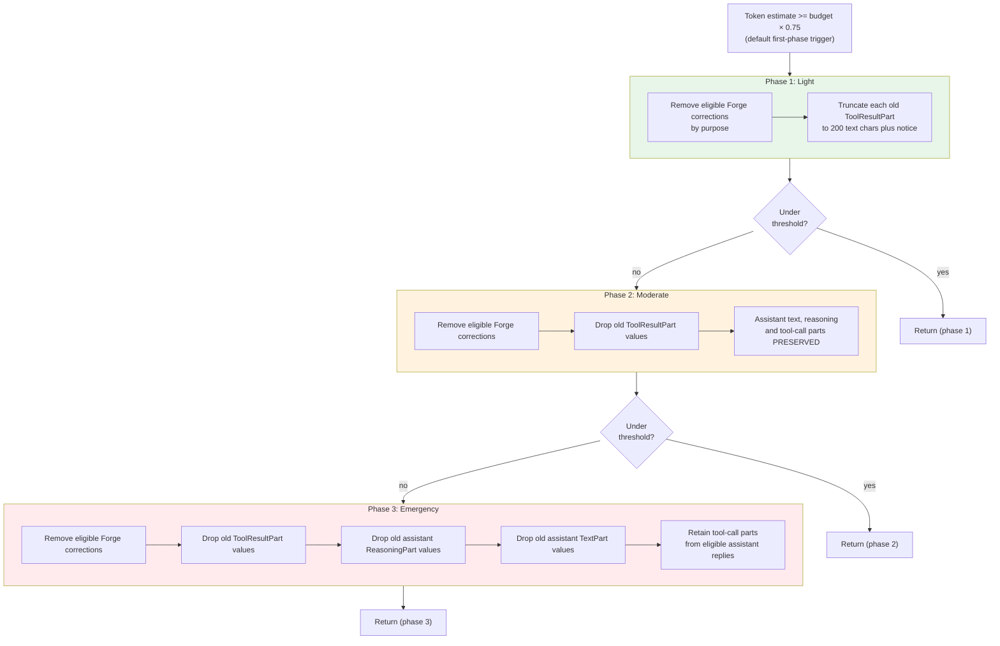
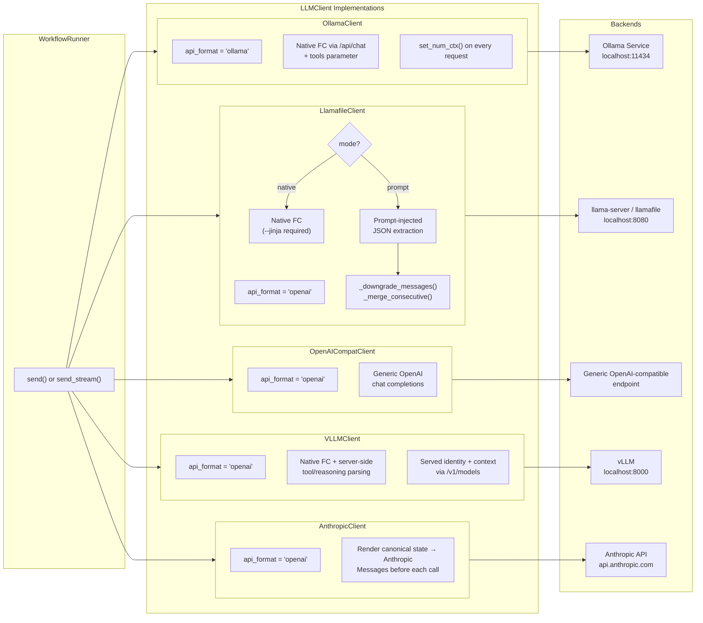
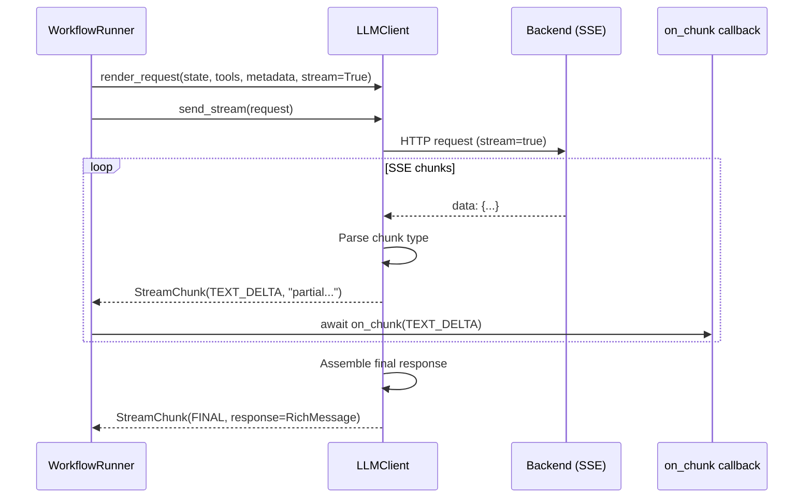
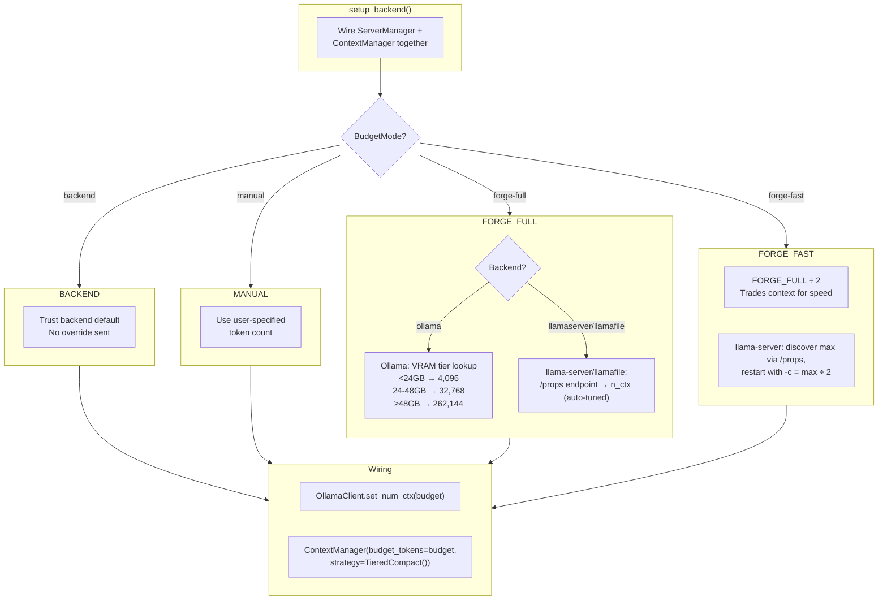
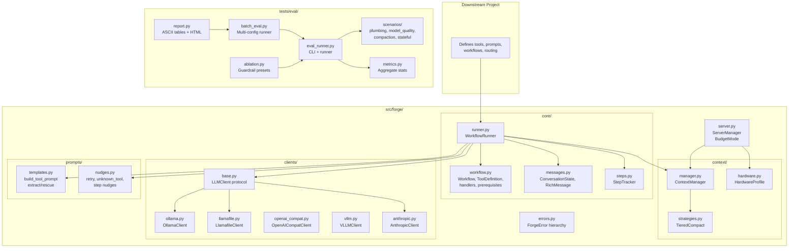

# Workflow

Visual guide to the forge agentic tool-calling loop.

---

## Quick Reference

**Entry Point:** `WorkflowRunner.run()` in `src/forge/core/runner.py`

**Critical Files:**
- `src/forge/core/inference.py` - run_inference() — shared "front half" (compact, render, validate, record, retry)
- `src/forge/core/runner.py` - Agentic loop "back half" (step enforcement, tool execution, terminal check)
- `src/forge/core/workflow.py` - Workflow, ToolDefinition, separate handlers/prerequisites
- `src/forge/core/messages.py` - ConversationState, RichMessage, typed parts
- `src/forge/core/steps.py` - StepTracker (used internally by StepEnforcer)
- `src/forge/guardrails/` - Composable middleware (ResponseValidator, StepEnforcer, ErrorTracker, Nudge)
- `src/forge/context/manager.py` - ContextManager, CompactEvent
- `src/forge/context/strategies.py` - TieredCompact (3-phase compaction)
- `src/forge/clients/base.py` - LLMClient protocol
- `src/forge/server.py` - ServerManager, BudgetMode, setup_backend()
- `src/forge/tools/respond.py` - Synthetic respond tool (respond_definition(), respond())
- `src/forge/prompts/nudges.py` - Retry, unknown-tool, and step nudges
- `src/forge/prompts/templates.py` - Prompt-injected tool prompt, extract/rescue

---

## Agentic Loop

Runner and Proxy use the same canonical inference lifecycle. Runner owns
configured context management, step/prerequisite enforcement and actual handler
execution. Proxy uses NoCompact, no warnings, no step enforcement and leaves
execution to its client.



Formatting retries consume the iteration budget. Malformed arguments use the
shared tool-error budget and never reach handlers. Callable failures retain the
`[ToolError]` channel and recovery behavior. `ToolResolutionError` produces
correlated error history without recording step completion or consuming the
callable-error budget. Step/prerequisite checks block the whole batch against
pre-batch state. A terminal handler does not bypass later handlers or post-batch
error bookkeeping.

## Message Lifecycle



On attempt-limit or validation exhaustion, inference flushes the existing
per-call messages to Runner callbacks, including the final rejected reply.
No unused correction or extra attempt is added. Transport exception behavior
is unchanged. Context warnings are callback events and outgoing-view additions,
never persistent canonical history.

### Role, parts and purpose

| View | Canonical representation | Owner |
|---|---|---|
| System/user seed | Role plus ordered `TextPart` values | Runner or supplied seed |
| Assistant reply | One message with ordered text, reasoning and calls | Shared inference |
| Accepted call | `ToolCallPart(name, ValidArguments(value), call_id)` | Validator/inference |
| Invalid call | `ToolCallPart` with `InvalidArguments(received)` | Validator; never executed |
| Execution result | `ToolResultPart(call_id, content, outcome)` | Runner |
| Corrections | `forge_purpose`: `retry`, `unknown_tool`, `tool_arg_validation`, `step`, `prerequisite` | Inference or Runner |
| Warning | `forge_purpose == "context_warning"` | Transient context event |

`step_index` and `forge_purpose` are direct Forge control fields. There is no
MessageType classifier or universal text projection. Display iterates ordered
parts; metrics count individual calls/names and reasoning parts, using purpose
and outcome/prefix to distinguish corrections from callable failures. Actual
terminal Python values stay local; successful non-string model-visible results
remain JSON text. Result `name` remains an applicable message extra.

---

## Compaction Phases

TieredCompact applies three escalating phases. Each phase fires only if the previous didn't reduce tokens below the threshold. All phases are deterministic text manipulation — no LLM calls.



**Protected window:** The first two messages and the `keep_recent` most recent loop iterations (default 2) are never compacted, regardless of phase. Only older messages in the eligible window are affected.

---

## Client Adapter Flow

The `LLMClient` protocol abstracts backend differences. The runner never sees
raw HTTP — it gets an assistant `RichMessage`. Built-in adapters cover
generic OpenAI-compatible endpoints, Ollama, llama-server/llamafile, vLLM, and
Anthropic. The protocol also requires an honest `get_context_length()` result
for budget discovery (`None` when unavailable).



### Streaming Flow



The diagram shows a successful stream. A stream ending without FINAL raises
`StreamError`; built-in clients do not automatically resend that request.
`RETRY` remains available for custom adapters that implement retry behavior,
and consumers should discard failed-attempt partial output when it is emitted.
The eval harness can retry a whole run separately; that is not a built-in
client transport retry.

---

## Budget Resolution

`ServerManager` resolves context budgets before the agentic loop starts. The budget flows into `ContextManager`, which uses it as the compaction threshold.

This diagram describes native `setup_backend()`/`WorkflowRunner` composition.
Proxy keeps the same managed allocation modes but always composes `NoCompact`;
it never mutates caller history. In unmanaged Proxy mode, `budget_tokens` and
metadata are reporting-only inputs for `/forge/usage`, and the backend
operator owns allocation, overflow, model swaps, and failures.



---

## Module Structure



---

## Data Types

### Core Types (`src/forge/core/workflow.py`)

```
Workflow
├── name: str
├── description: str
├── tools: dict[str, ToolDefinition]   # ordered model-visible definitions
├── handlers: dict[str, Callable]      # execution keyed by tool name
├── prerequisites: dict[str, list]     # conditional dependencies keyed by name
├── required_steps: list[str]          # must be called before terminal
├── terminal_tool: str | list[str]     # tool(s) that end the workflow
├── terminal_tools: frozenset[str]     # normalized (init=False)
└── system_prompt_template: str        # may contain {placeholders}

ToolDefinition
├── name: str
├── description: str                   # defaults to empty string
├── input_schema: dict                 # complete schema
└── extra_fields: dict                 # applicable function-tool extras
```

### Canonical History (`src/forge/core/messages.py`)

```text
ConversationState(messages: list[RichMessage])
RichMessage(role, parts, step_index=None, forge_purpose=None, extra_fields={})
TextPart(text, extra_fields={})
ReasoningPart(text, extra_fields={}, field_name=None)
ToolCallPart(name, arguments: ValidArguments | InvalidArguments, call_id="")
ToolResultPart(call_id, content: list[TextPart], outcome="success")
```

Backend replies, callbacks and supplied seeds all use this surface. See the
[Python migration examples](USER_GUIDE.md#multi-turn-conversations) for concrete
old-to-new authoring and callback operations.

### Streaming Types (`src/forge/clients/base.py`)

```
StreamChunk
├── type: ChunkType                    # TEXT_DELTA, TOOL_CALL_DELTA, FINAL, RETRY
├── content: str                       # partial text for deltas
└── response: RichMessage | None       # only set when type == FINAL
```

---

## Command Reference

```bash
# Run unit tests (no backend needed)
python -m pytest tests/ -v --tb=short

# Run with coverage
python -m pytest tests/ --cov=forge --cov-report=term-missing

# Eval: single model, all scenarios
python -m tests.eval.eval_runner --backend ollama --model "ministral-3:8b-instruct-2512-q4_K_M" --runs 10 --stream --verbose

# Eval: specific scenarios
python -m tests.eval.eval_runner --backend ollama --model "ministral-3:8b-instruct-2512-q4_K_M" --runs 10 --scenario basic_2step sequential_3step

# Eval: llama-server (start server in separate terminal first)
python -m tests.eval.eval_runner --backend llamafile --llamafile-mode native --gguf path/to/Ministral-3-14B-Instruct-2512-Q4_K_M.gguf --runs 10 --stream

# Eval: Anthropic baseline
python -m tests.eval.eval_runner --backend anthropic --model claude-haiku-4-5-20251001 --runs 5 --stream

# Batch eval (multi-model, auto-resume)
python -m tests.eval.batch_eval --config ollama --runs 50

# Check batch progress
python -m tests.eval.report eval_results.jsonl --progress

# Probe context budget (no eval run)
python -m tests.eval.eval_runner --backend ollama --model "ministral-3:8b-instruct-2512-q4_K_M" --probe
```

See [ARCHITECTURE.md](ARCHITECTURE.md) for the full design document.
